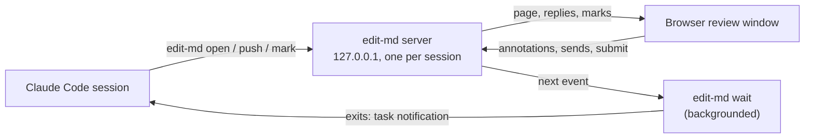

# LaLaMo-Mado

[](https://claude.com/claude-code)
[](LICENSE)

Review Markdown in the browser, with your agent in the loop.

The agent opens a `.md` file in a browser window.
You read it there and annotate: comment on a sentence, label a block, ask a question, mark what to remove or where to insert.
The agent gets back only structured annotations anchored to file lines, never the document pasted back into the chat.
It answers in the page while you keep reading, applies your notes, and re-opens the revised version with the changes highlighted.

The tool itself is called `edit-md`: that is what you install, and `/edit-md` is what you type in Claude Code.

## Why

Your attention is the scarce part of working with an agent, and the usual surfaces spend it.
In a chat pane you quote lines back, scroll for the answer to your third question, and watch the agent re-read or re-print the document until the context is full of copies of it.
Editor extensions bolt review onto tools built for writing code.
Dictation into a prompt box hands the agent text it cannot trust.

Here the file stays on disk.
The page shows it rendered, and you point at the exact spot you mean.
The agent receives `{label, text, quote, lines}`, reads only the lines it needs, and answers next to what you marked.

## What it does

- **Annotate in place.** Select text and a comment popup opens on it; Alt+click picks a whole block, a table row being the smallest.
  Labels (Comment, Question, Change, Remove, Insert, Looks good, Not this, Seek) prefix a comment or stand alone, and you can define your own.
- **Stamp blocks.** Arm a label, then click block after block to tag them with no text.
- **Talk mid-read.** *Send now* asks one question and the answer appears threaded under it; *Send drafts (N)* hands over a group to act on silently.
  Finish with *Approve*, *Apply & review* (another round, with a diff) or *Apply silently*.
- **Choose who answers.** Your session, or a separate headless `claude -p` run: blank, with the repo's context, briefed by the session, or allowed to edit.
  Separate runs keep the session's context clean.
- **Agent marks.** The agent highlights spans for you: decisions to take, risks, the findings of a 🔍 Seek, each listed in the left pane.
- **Diff since you last looked.** Blocks changed since you last saw the document are marked, even across sessions.
- **Dictation the agent can read.** Ctrl+D dictates into a comment, in English or Czech, through Chrome's speech service or a local Whisper model.
  The agent is told which words you spoke and which you typed; see [Speak your review](#speak-your-review).
- **Skills in comments.** Ctrl+Space inserts a `/skill` name from your own and the repo's skills.
- **Rendering.** Server-side Markdig with source-line mapping; Mermaid diagrams and front matter render and can be annotated.
- **Settings the agent can change.** ⚙ lists every setting; the agent reads and changes them with `edit-md settings`, and the open page updates at once.
- **A page that is yours.** Plain HTML, JS and CSS with no build step, on a server that does the heavy lifting; see [Make it yours](#make-it-yours).

## Speak your review

Dictation into a prompt box ends up as text in the prompt.
Nothing tells the agent which words you spoke and which you typed, so a misheard word reads like an instruction, and you cannot teach the recognizer your own terms.

The review page silently tags every character of a comment as spoken or typed.
Say *the secret results should stay in the pain*, type *seek* over *secret*, then type *see XTbl* at the end, and the agent receives:

```json
{"text": "the seek results should stay in the pain see XTbl",
 "dictated": true,
 "spoken": ["the", "results should stay in the pain"]}
```

The typed words, *seek* and *XTbl*, it takes exactly as written and never "fixes".
The spoken ones it reads against the document: *pain*, in a note about a layout, is most likely *pane*.

On top of that tagging:

- **The recognizer's second guesses.** Where the speech engine was unsure, its alternatives travel with the comment as `maybe`.
  In Czech dictation the English *seek* can come through as *jí*, with *zík* among the alternatives: enough for the agent to see what you meant.
- **✨ Fix before you send.** One click has the agent correct the misheard words in your comment against the document.
  Its suggestion appears under the comment box and never overwrites it; *Use* takes it.
- **A glossary that learns.** Type over a misheard term and the page offers *Remember "ex table" → XTbl*, for this repo or just for you.
  From then on it is corrected as you speak, even while the words are still being recognized.
- **Local Whisper that knows your words.** The optional on-PC model takes the glossary as its prompt.
  In the end-to-end test, a Czech voice saying the made-up term *XTbl* comes out as "Rex Table" from plain Whisper, and as `XTbl` with the glossary.
- **Two ears on one take.** Keep Local beside Chrome (a ⚙ switch), and ✨ Fix also sends Whisper's transcript of the same speech; the agent reconciles the two word by word.

## Make it yours

The split is deliberate: the server carries the weight, and the page is yours.

The server holds what is hard to get right:

- the document model, and the map from every rendered block back to its source lines;
- anchoring a selection to exact file lines, and the diff since you last looked;
- the event queue that wakes the agent, with delivery acknowledged and re-sent if a wake-up dies;
- separate `claude -p` runs, the skill catalog, the glossary, Whisper, and settings in layers (PC, repo, session, document).

The page is plain HTML, JavaScript and CSS with no build step, talking to that server over a small HTTP API.
Change a file, reload, and it is changed.

We think the era of one editor for everyone is ending.
With an agent at hand, people shape their tools to how they work, and we expect most users to end up with their own spin of this one.
Getting there is a sentence away:

- **Ask from the page.** ⚙ → *Customize the page*: say what you want, and the agent changes the page for you.
- **Overlay.** Changed copies of a few files go into `~/.claude/edit-md/client/`; the server serves them first, and a reinstall keeps them.
- **A whole variant.** Your own client folder, run with `serve --client <dir>` or `EDIT_MD_CLIENT_DIR`.
- **Labels and send buttons** are JSON: `comment_labels.json` and `send_buttons.json` in `~/.claude/edit-md/` (yours) or `<repo>/.claude/edit-md/` (the repo's).
- **Settings** the agent finds and changes with `edit-md settings`; ⚙ → *Setting* or *New comment kind* asks for one from the page.

## How it works



- `edit-md serve` runs a local HTTP server (.NET 10, ASP.NET Core) for the session and owns the document model, the source-line map and the diff.
- The agent drives it with short CLI calls, each printing one JSON line.
- A backgrounded `edit-md wait` blocks until the next browser event; its exit wakes the agent, so the chat stays free while you read.
- Each session gets its own browser window, in a dedicated Chrome, Chromium or Edge profile, never your everyday one.

### Other agents

LaLaMo-Mado is built and tested with Claude Code, but the idea is not tied to it: a Markdown file on disk, comments anchored to its lines, and a channel back to the agent's session.
The core is a local server and a CLI that prints JSON, with `edit-md wait` blocking until the next event, so any agent that can run shell commands can drive the loop.
Claude Code's own parts are the skill that teaches the loop, the background wake-up, separate runs through `claude -p`, and the skill picker, which reads `.claude/skills/`.
Outside Claude Code there is no session ID, so set `EDIT_MD_HOME` per session, or all sessions share one server.

## Requirements

- [Claude Code](https://claude.com/claude-code).
- To build: the .NET 10 SDK, PowerShell 7 and `git`.
- Chrome, Chromium or Edge for the dedicated review window; dictation needs Chrome or Edge, a microphone and the internet.
- Optional local dictation: about 2 GB of downloads; an NVIDIA GPU makes it fast, and without one it runs slowly on the CPU.

Windows is the only platform tested so far.
The code avoids Windows-only APIs, but nobody has driven it on macOS or Linux yet, and the local-dictation installer is Windows-only.

## Install

The installer guide, [onboarding/README.md](onboarding/README.md), is written for the agent, so the easiest way is to ask Claude Code to follow it.
By hand:

```bash
git clone https://github.com/mrJC0/lalamo-mado.git
cd lalamo-mado
pwsh onboarding/install.ps1
```

It builds a self-contained binary and installs two things, nothing else (no rules, hooks or settings):

| where | what |
|---|---|
| `~/.claude/skills/edit-md/SKILL.md` | the skill, text only |
| `~/.claude/bin/edit-md/` | the binary and the browser page (~55 MB) |

The binary stays out of `skills/` because many people keep `~/.claude` in git.
For local dictation, run `pwsh onboarding/install-whisper.ps1` as well.
Update with `git pull` and the same install; uninstall steps are in the installer guide.

## Use

In Claude Code:

```
/edit-md path/to/file.md
```

Try it on `samples/demo.md`.
Select a sentence, write a comment, press *Send now*, and the agent's answer appears under it.

Default keys (⚙ lists them all):

| key | does |
|---|---|
| select text | open the comment popup on it |
| Alt+click | comment on a whole block |
| Ctrl+Shift, tapped | label palette; then click blocks to stamp them |
| Alt+digit | arm the label on that digit (❓ 4, 👍 5, 👎 6 by default) |
| Ctrl+D | start or stop dictation |
| Ctrl+Space | insert a skill name |
| Esc | close the topmost thing |

## Develop

```bash
dotnet build lalamo-mado.slnx
dotnet test lalamo-mado.slnx
node tests/e2e/roundtrip.mjs src/LalamoMado/bin/Debug/net10.0/edit-md
```

`roundtrip.mjs` drives the real server through headless Chrome and the agent-side CLI.
The other scripts in `tests/e2e/` need more: a local Whisper install, the network, or the real `claude` (which costs a little).

| path | holds |
|---|---|
| `src/LalamoMado/` | the server and the CLI |
| `src/LalamoMado/client/` | the review page, no build step |
| `onboarding/` | the installers and the skill |
| `.claude/project-plans/` | the design record, one plan per feature |
| `samples/demo.md` | a document to try it on |

## The name

**La**rge **La**nguage **Mo**del, **Ma**rk**do**wn.
窓 (*mado*) is also Japanese for "window", which is what it opens.

## Credits

Built by Jan Cernohub together with Claude, Anthropic's model, working in [Claude Code](https://claude.com/claude-code).
Claude (Opus 4.8, then Opus 5.5) co-wrote it throughout: the design plans, the code and the tests.

## Third-party

Mermaid 12.1.0 is vendored in `src/LalamoMado/client/vendor/` under its MIT license.
Markdig and Whisper.net come from NuGet.
The Whisper models and NVIDIA's CUDA runtime DLLs are downloaded only on the opt-in install, each SHA-256 checked, under their own licenses.

## License

MIT: see [LICENSE](LICENSE).
Use it, change it, share it; it comes as is, with no warranty.
