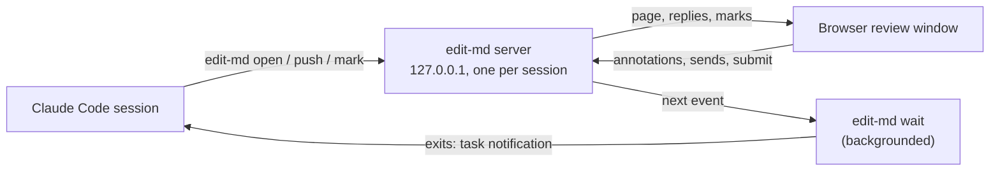

# LaLaMo-Mado

Review Markdown in the browser, with Claude Code in the loop.

The agent opens a `.md` file in a browser window.
You read it there and annotate: comment on a sentence, label a block, ask a question, mark what to remove or where to insert.
The agent gets back only structured annotations anchored to file lines, never the document pasted back into the chat.
It answers in the page while you keep reading, applies your notes, and re-opens the revised version with the changes highlighted.

The tool itself is called `edit-md`: that is what you install, and `/edit-md` is what you type in Claude Code.

## Why

Plans, specs and long answers an agent writes are hard to review in a chat window.
You end up quoting lines back, the agent re-reads or re-prints the whole thing, and the context fills with copies of one document.

Here the file stays on disk.
The page shows it rendered, and you point at the exact spot you mean.
The agent receives `{label, text, quote, lines}` and reads only the lines it needs.

## What it does

- **Annotate in place.** Select text and a comment popup opens on it; Alt+click picks a whole block, a table row being the smallest.
  Labels (Comment, Question, Change, Remove, Insert, Looks good, Not this, Seek) prefix a comment or stand alone, and you can define your own.
- **Stamp blocks.** Arm a label, then click block after block to tag them with no text.
- **Talk mid-read.** *Send now* asks one question and the answer appears threaded under it; *Send drafts (N)* hands over a group to act on silently.
  Finish with *Approve*, *Apply & review* (another round, with a diff) or *Apply silently*.
- **Choose who answers.** Your session, or a separate headless `claude -p` run: blank, with the repo's context, briefed by the session, or allowed to edit.
  Separate runs keep the session's context clean.
- **Agent marks.** The agent highlights spans for you: decisions to take, risks, the findings of a 🔍 Seek, each listed in the left pane.
- **Diff since you last looked.** Blocks changed since you last saw the document are marked, even across sessions.
- **Dictation.** Ctrl+D dictates into a comment through Chrome's speech service, in English or Czech.
  An optional local Whisper model transcribes on your PC instead.
  ✨ Fix asks the agent to correct misheard words against the document, and a glossary of your terms learns from your corrections.
- **Skills in comments.** Ctrl+Space inserts a `/skill` name from your own and the repo's skills.
- **Rendering.** Server-side Markdig with source-line mapping; Mermaid diagrams and front matter render and can be annotated.
- **Settings the agent can change.** ⚙ lists every setting; the agent reads and changes them with `edit-md settings`, and the open page updates at once.
- **A page meant to be tailored.** The client is plain HTML, JS and CSS with no build step; changed files go into an overlay folder that survives reinstalls.

## How it works



- `edit-md serve` runs a local HTTP server (.NET 10, ASP.NET Core) for the session and owns the document model, the source-line map and the diff.
- The agent drives it with short CLI calls, each printing one JSON line.
- A backgrounded `edit-md wait` blocks until the next browser event; its exit wakes the agent, so the chat stays free while you read.
- Each session gets its own browser window, in a dedicated Chrome, Chromium or Edge profile, never your everyday one.

## Requirements

- [Claude Code](https://claude.com/claude-code).
- To build: the .NET 10 SDK, PowerShell 7 and `git`.
- Chrome, Chromium or Edge for the dedicated review window; dictation needs Chrome or Edge, a microphone and the internet.
- Optional local dictation: about 2 GB of downloads; an NVIDIA GPU makes it fast, and without one it runs slowly on the CPU.

Windows is the only platform tested so far.
The code avoids Windows-only APIs, but nobody has driven it on macOS or Linux yet, and the local-dictation installer is Windows-only.

## Install

The installer guide, [onboarding/README.md](onboarding/README.md), is written for the agent, so the easiest way is to ask Claude Code to follow it.
By hand:

```bash
git clone https://github.com/mrJC0/lalamo-mado.git
cd lalamo-mado
pwsh onboarding/install.ps1
```

It builds a self-contained binary and installs two things, nothing else (no rules, hooks or settings):

| where | what |
|---|---|
| `~/.claude/skills/edit-md/SKILL.md` | the skill, text only |
| `~/.claude/bin/edit-md/` | the binary and the browser page (~55 MB) |

The binary stays out of `skills/` because many people keep `~/.claude` in git.
For local dictation, run `pwsh onboarding/install-whisper.ps1` as well.
Update with `git pull` and the same install; uninstall steps are in the installer guide.

## Use

In Claude Code:

```
/edit-md path/to/file.md
```

Try it on `samples/demo.md`.
Select a sentence, write a comment, press *Send now*, and the agent's answer appears under it.

Default keys (⚙ lists them all):

| key | does |
|---|---|
| select text | open the comment popup on it |
| Alt+click | comment on a whole block |
| Ctrl+Shift, tapped | label palette; then click blocks to stamp them |
| Alt+digit | arm the label on that digit (❓ 4, 👍 5, 👎 6 by default) |
| Ctrl+D | start or stop dictation |
| Ctrl+Space | insert a skill name |
| Esc | close the topmost thing |

## Tailor it

- **Labels:** `comment_labels.json` in `~/.claude/edit-md/` (yours) or `<repo>/.claude/edit-md/` (the repo's).
- **Send buttons:** `send_buttons.json`, same places: a whole way of answering in one click.
- **The page:** copy a file from `~/.claude/bin/edit-md/client/` to `~/.claude/edit-md/client/` and edit it there.
- Or ask from the page: ⚙ offers *Setting*, *Customize the page* and *New comment kind*, which the agent carries out.

## Develop

```bash
dotnet build lalamo-mado.slnx
dotnet test lalamo-mado.slnx
node tests/e2e/roundtrip.mjs src/LalamoMado/bin/Debug/net10.0/edit-md
```

`roundtrip.mjs` drives the real server through headless Chrome and the agent-side CLI.
The other scripts in `tests/e2e/` need more: a local Whisper install, the network, or the real `claude` (which costs a little).

| path | holds |
|---|---|
| `src/LalamoMado/` | the server and the CLI |
| `src/LalamoMado/client/` | the review page, no build step |
| `onboarding/` | the installers and the skill |
| `.claude/project-plans/` | the design record, one plan per feature |
| `samples/demo.md` | a document to try it on |

## The name

**La**rge **La**nguage **Mo**del, **Ma**rk**do**wn.
窓 (*mado*) is also Japanese for "window", which is what it opens.

## Credits

Built by Jan Cernohub together with Claude, Anthropic's model, working in [Claude Code](https://claude.com/claude-code).
Claude (Opus 4.8, then Opus 5.5) co-wrote it throughout: the design plans, the code and the tests.

## Third-party

Mermaid 12.1.0 is vendored in `src/LalamoMado/client/vendor/` under its MIT license.
Markdig and Whisper.net come from NuGet.
The Whisper models and NVIDIA's CUDA runtime DLLs are downloaded only on the opt-in install, each SHA-256 checked, under their own licenses.

## License

MIT: see [LICENSE](LICENSE).
Use it, change it, share it; it comes as is, with no warranty.
