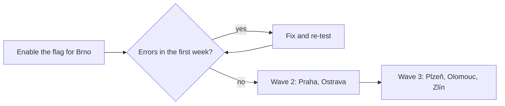

# Release checklist — invoice export v2

This note proposes how we ship the **invoice export v2** to the branch offices.
It is a test document for `edit-md`: select any text, pick a label, comment, and send it back.

## Scope

- Export invoices as CSV and PDF.
- Keep the old XML export until every branch has switched.
- Drop the nightly FTP upload; branches pull from the [portal](https://example.com/portal) instead.

The export runs once per branch per night.
The export runs on the reporting replica, never on the primary.

## Rollout plan

1. Enable the feature flag for the Brno branch.
2. Watch the error dashboard for a week.
3. Roll out to the remaining branches in two waves.

| Wave | Branches              | Date       |
|------|-----------------------|------------|
| 1    | Brno                  | 2026-11-02 |
| 2    | Praha, Ostrava        | 2026-11-16 |
| 3    | Plzeň, Olomouc, Zlín  | 2026-11-30 |



## Configuration

```json
{
  "export": { "formats": ["csv", "pdf"], "replica": "reporting-ro" },
  "ftpUpload": false
}
```

> Open question: do the branches need a signed PDF, or is the portal download enough?

## Risks

The CSV encoding must stay **Windows-1250** for the accounting tool — UTF-8 breaks Czech diacritics like *Plzeň* and *příjemce*.
If the replica lags, the export may miss invoices issued in the last minutes before midnight.
